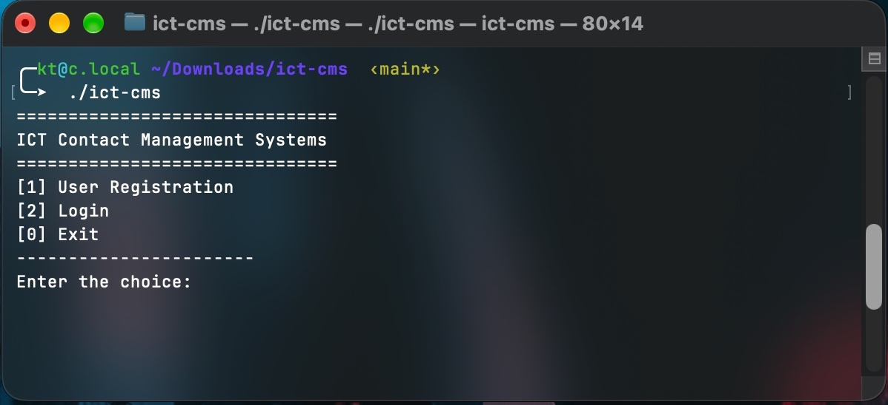

# ICT-CMS — ICT Contact Management System

Final project for **ITCS 200 – Fundamental Programming**, Faculty of ICT, Mahidol University (MUICT).

A console contact book in C. Students and admins register, log in, and manage contact information.



## Features

- **Register** with ID, name, phone, email and password. Each field is checked: ID must be 7 digits, phone 10 digits, email must contain `@`, password at least 8 characters.
- **Login** — an ID starting with `00` logs in as **Admin**; any other ID logs in as **Student**.
- **Student menu:** edit own contact, show all contacts, search contacts.
- **Admin menu:** edit any user's contact, show all, search, delete users.
- **Partial search** by first name, ignoring case (`som` finds *Somchai* and *Srisomsri*).
- **Extra feature:** contacts are listed sorted by ID.

## Build & Run

```sh
make
./ict-cms
```

Without `make` (e.g. on Windows):

```sh
gcc -o ict-cms main.c auth.c menu.c contact.c input.c
```

## Files

| File | Purpose |
|---|---|
| `main.c` | Main menu |
| `auth.c` / `.h` | Registration and login |
| `menu.c` / `.h` | Student/admin menus: edit, show, search, delete |
| `contact.c` / `.h` | Contact data, find, sort, delete, table printing |
| `input.c` / `.h` | Input reading, validation, screen helpers |

## Note

Data is stored in memory only, so all contacts are lost when the program exits.
